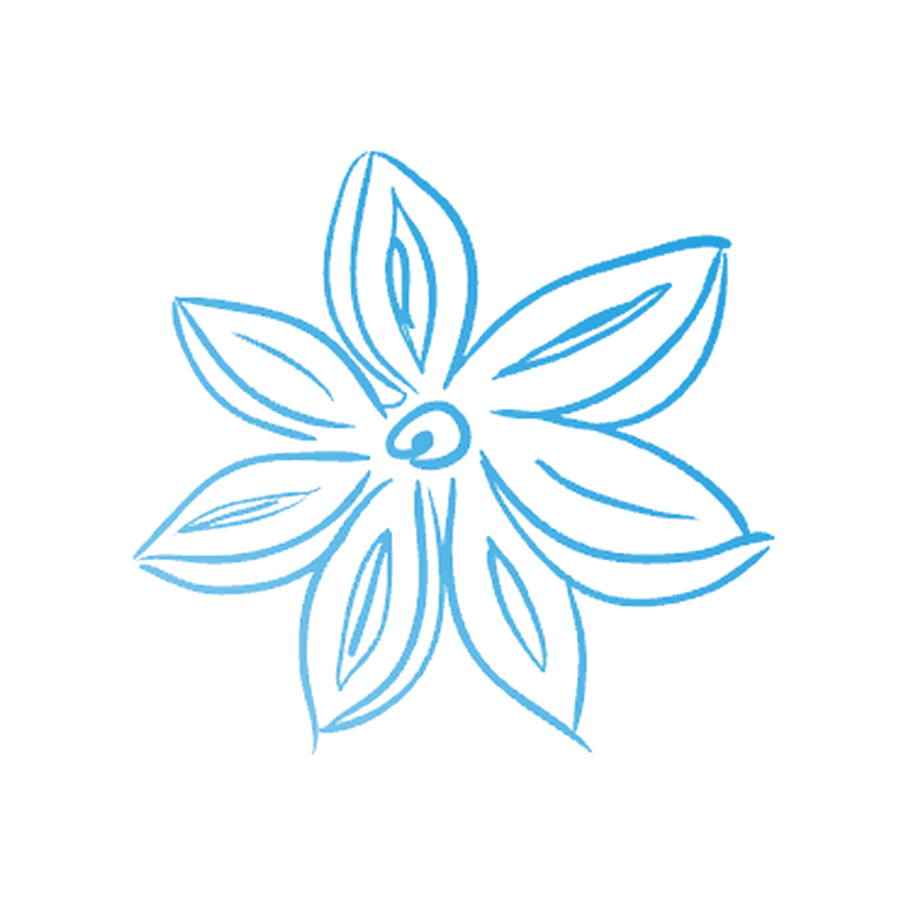
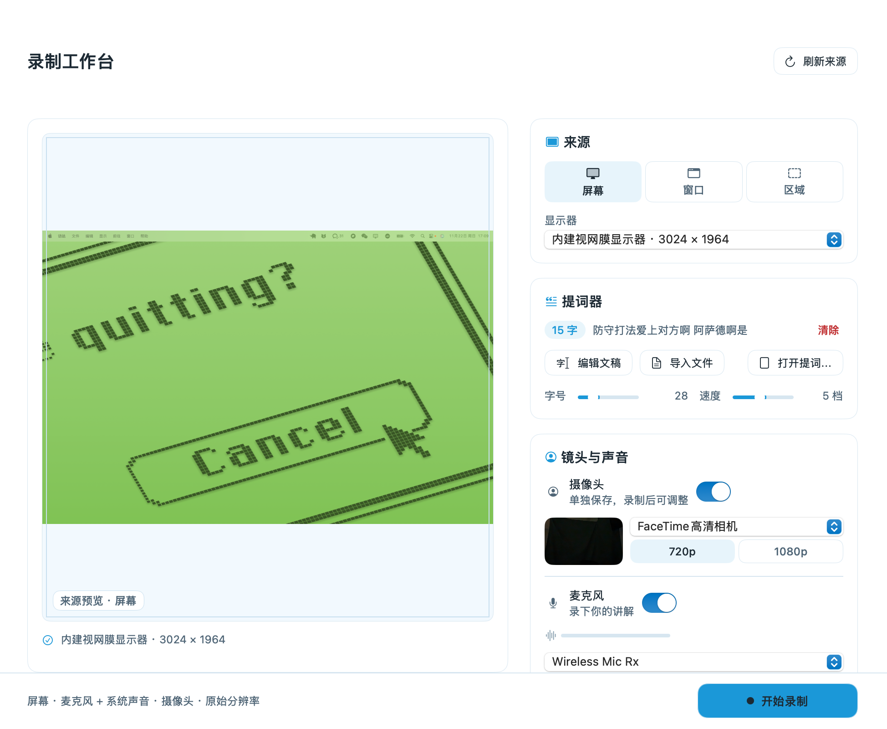
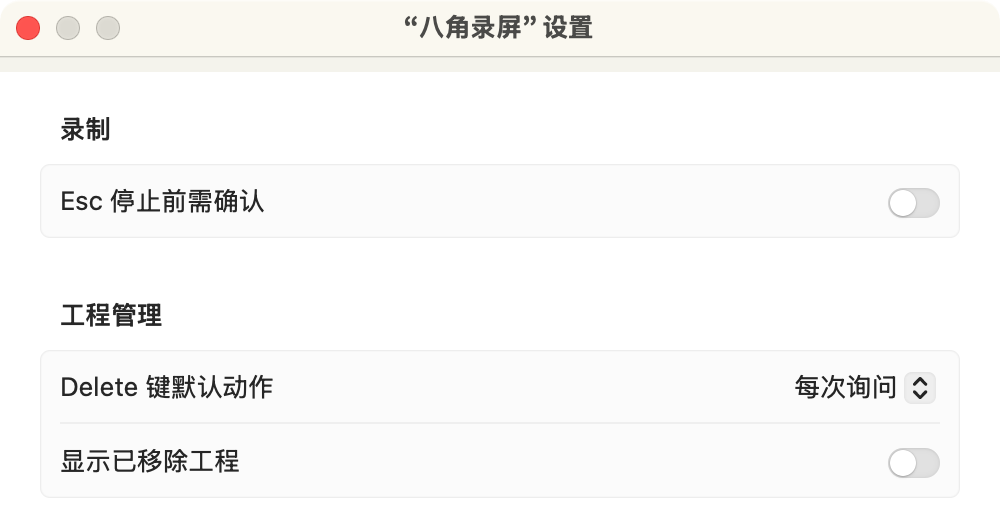

<p align="center">
  
</p>

<h1 align="center">anise-recorder · 八角录屏</h1>

<p align="center">
  <b>The local-first macOS screen recorder & demo editor.</b><br>
  <b>本机运行的 macOS 录屏与演示编辑工具。</b>
</p>

<p align="center">
  <a href="#english">English</a> · <a href="#中文">中文</a>
</p>

<p align="center">
  <a href="https://github.com/questionjie-max/anise-recorder/blob/main/LICENSE"></a>
  <a href="https://github.com/questionjie-max/anise-recorder/actions/workflows/ci.yml"></a>
  
  
  
  
</p>

<p align="center">
  
</p>
<p align="center"><sub>录制工作台 · recording workbench</sub></p>

---

## English

### Why another recorder?

Most screen-recording tools want your footage to leave your Mac: cloud
uploads behind subscriptions, watermarked free tiers, accounts required
before export. But demo videos, course recordings and bug reports are
yours — they should never have to travel anywhere you didn't choose.

**anise-recorder (八角录屏) keeps the whole pipeline on your Mac.** It
records screen, window or region together with microphone, system audio
and camera as **separate tracks** (native ScreenCaptureKit), then gives you
a real multi-track editor — click-to-zoom, camera compositions, smart cut,
captions, redaction — and one-click export. No account, no upload, no
telemetry, no third-party runtime dependencies.

### Highlights

- **Three capture sources** — a full display, a single window (including
  windows on other Spaces), or a dragged region.
- **Recording controls you cannot lose** — a floating HUD on the recorded
  screen, a red menu-bar item, and a Dock status page that brings the main
  window back mid-recording.
- **Click-to-zoom** — every click gently zooms in and springs back. Choose
  the hold time and zoom factor before recording, or turn it off.
- **Camera compositions & green screen** — six composition presets, PiP
  with rounded/circular masks, on-device Vision person segmentation, and
  chroma-key green screen with auto color-field sampling and light wrap.
- **Multi-track editor** — video, camera, zoom, audio and overlay tracks;
  trim, split, 0.25×–4× speed with pitch preserved, smart cut for silence
  and filler words, timed redaction, audio one-click enhance.
- **Captions, offline** — manual captions or SRT import, plus on-device
  speech recognition (`requiresOnDeviceRecognition`) that fails explicitly
  instead of falling back to the cloud. Glossary, styles, bilingual cues,
  chapters.
- **Local by design** — no network access, no account, no cloud; projects
  live in `~/Movies/八角录屏/`.

<p align="center">
  
</p>
<p align="center"><sub>设置 · settings</sub></p>

### Install

- **Download** the notarized DMG from
  [Releases](https://github.com/questionjie-max/anise-recorder/releases):
  [anise-recorder-0.7.0.dmg](https://github.com/questionjie-max/anise-recorder/releases/download/v0.7.0/anise-recorder-0.7.0.dmg)
  (macOS 15+, Apple Silicon).
- **Build from source** (Xcode 16+ / Swift 6.0 toolchain):

```bash
swift build
./scripts/build_app.sh
open 八角录屏.app
```

### Quick start

1. Open 八角录屏.app and choose a display, a window, or drag a region.
2. Pick camera, microphone, and system audio; optionally configure
   click-to-zoom and the teleprompter.
3. Start recording. Use the HUD, the menu-bar icon, or the Dock status page
   to pause or stop.
4. Edit on the timeline, then export MP4 / GIF (a matching `.srt` rides
   along when captions exist).

### Privacy

No network, no telemetry, no accounts. Screen recordings, camera files,
microphone audio and projects stay on your Mac. Keystroke captions (off by
default) are stored only inside the project file. See
[PRIVACY.md](PRIVACY.md).

### Development

```bash
swift test --parallel    # full suite (long-export test gated by env var)
```

CI runs the same suite on `macos-15`. Tests that need screen-recording /
camera TCC permissions must be verified with the packaged app — see
[docs/TESTING.md](docs/TESTING.md) and [docs/DEVELOPMENT.md](docs/DEVELOPMENT.md).

### Docs

[Features & boundaries (中文)](docs/FEATURES.md) · [Architecture](docs/ARCHITECTURE.md) ·
[Development](docs/DEVELOPMENT.md) · [Testing](docs/TESTING.md) · [Roadmap](docs/ROADMAP.md) ·
[Design system](docs/design/DESIGN_SYSTEM.md) · [Changelog](CHANGELOG.md) ·
[llms.txt](llms.txt) · [AGENTS.md](AGENTS.md)

### Contributing & License

PRs welcome — read [CONTRIBUTING.md](CONTRIBUTING.md) first. Please note our
[Code of Conduct](CODE_OF_CONDUCT.md) and
[security policy](SECURITY.md) (security issues: private report, not public
issues). Released under [Apache-2.0](LICENSE).

---

## 中文

### 为什么又做一个录屏工具？

大多数录屏工具都想让你的录像离开这台 Mac：云上传锁在订阅后面、免费版
打水印、导出前先注册账号。但演示视频、课程录像和 bug 报告是你的东西——
它们不该被送去任何你没有选择的地方。

**八角录屏（anise-recorder）把整条流水线留在本机。** 用原生
ScreenCaptureKit 把屏幕 / 窗口 / 区域与麦克风、系统声音、摄像头**分开**
录制，再给你一个真正的多轨编辑器——点击放大、摄像头构图、智能精剪、
字幕、打码——以及一键导出。不需要账号，不上传云端，不做遥测，零第三方
运行时依赖。

### 亮点

- **三种来源**：整屏、单个窗口（含其他 macOS 桌面上的窗口），或拖拽框选
  区域。
- **录制中永远找得到操作**：被录屏上的悬浮 HUD、菜单栏红色录制图标，以及
  点 Dock 弹回的主窗口状态页。
- **点击放大**：每次点击自动放大再回弹；录制前可设停留时长与倍率，也可以
  关闭。
- **摄像头构图与绿幕**：六个构图预设、圆角 / 圆形画中画、本机 Vision 人像
  分割，以及带自动取色色场与边缘光包裹的绿幕抠像。
- **多轨编辑器**：视频、摄像头、缩放、声音、素材叠加五条轨道；裁剪、分割、
  0.25×–4× 变速（保持音高）、精剪停顿与口头禅、定时打码、音频一键优化。
- **本机字幕**：手动字幕或 SRT 导入，加上本机离线语音识别
  （`requiresOnDeviceRecognition`），不可用时明确失败而不是切云端。术语表、
  样式预设、双语字幕、章节。
- **本机优先**：不联网、不注册、不上传；工程保存在 `~/Movies/八角录屏/`。

### 安装

- **下载**：包含已公证 App 的 DMG（macOS 15+，Apple Silicon），见
  [Releases](https://github.com/questionjie-max/anise-recorder/releases)：
  [anise-recorder-0.7.0.dmg](https://github.com/questionjie-max/anise-recorder/releases/download/v0.7.0/anise-recorder-0.7.0.dmg)。
- **从源码构建**（需 Xcode 16+ / Swift 6.0 工具链）：

```bash
swift build
./scripts/build_app.sh
open 八角录屏.app
```

### 快速开始

1. 打开八角录屏，选择整屏、窗口或框选区域。
2. 选择摄像头、麦克风和系统声音；需要时配置点击放大与提词器。
3. 开始录制。用悬浮 HUD、菜单栏图标或 Dock 弹回的状态页暂停 / 停止。
4. 在时间线上剪辑，导出 MP4 / GIF（有字幕时自动写出同名 `.srt`）。

### 隐私

不联网、不做遥测、不需要账号。屏幕录像、摄像头素材、麦克风声音和工程都
留在本机；按键小条（默认关闭）只写入本机工程文件。详见
[PRIVACY.md](PRIVACY.md)。

### 开发

```bash
swift test --parallel    # 全量测试（长导出验收由环境变量开关控制）
```

CI 在 `macos-15` 上运行同一套测试。需要录屏 / 摄像头系统权限的验收必须用
打包后的 App 复核——见 [docs/TESTING.md](docs/TESTING.md) 与
[docs/DEVELOPMENT.md](docs/DEVELOPMENT.md)。

### 文档

[完整功能与边界](docs/FEATURES.md) · [架构](docs/ARCHITECTURE.md) ·
[开发与发布](docs/DEVELOPMENT.md) · [测试与验收](docs/TESTING.md) ·
[路线图](docs/ROADMAP.md) · [设计规范](docs/design/DESIGN_SYSTEM.md) ·
[变更记录](CHANGELOG.md) · [llms.txt](llms.txt) · [AGENTS.md](AGENTS.md)

### 参与贡献与许可

欢迎 PR——请先读 [CONTRIBUTING.md](CONTRIBUTING.md)。参与即表示同意
[行为准则](CODE_OF_CONDUCT.md)；安全问题请走
[私密报告](SECURITY.md)，不要开公开 Issue。项目以
[Apache-2.0](LICENSE) 分发。
